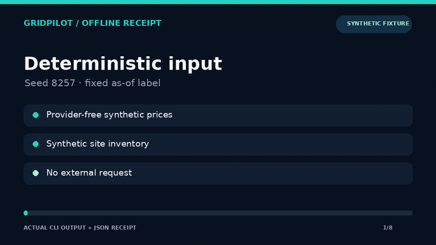

# GridPilot-GT offline workflow

GridPilot-GT contains an energy-allocation research prototype. The verified path in this repository is a **provider-free synthetic fixture**: it generates synthetic price and inventory inputs, builds a 24-period forecast and bid vector, computes a VCG allocation, estimates cooling demand, and prepares a dispatch payload without submitting anything to a market.



[Watch the MP4](docs/demo/offline-gridpilot.mp4) · [Inspect the deterministic receipt](docs/demo/offline-cycle.json)

## Run the verified workflow

```bash
python -m pip install --requirement requirements-offline.txt
python main.py --mode gridpilot --simulate 1 --seed 8257 \
  --as-of 2026-10-13T00:00:00Z \
  --receipt artifacts/offline-cycle.json
```

The command exits nonzero on failure and writes a stable JSON receipt. Repeating it with the same seed produces the same receipt bytes. Offline receipts are rejected in live mode so fixture evidence cannot be mislabeled as a live run.

## Verify tests and demo provenance

```bash
python -m pytest -q \
  hackathon/tests/test_offline_cycle.py \
  hackathon/tests/test_offline_cli.py
python scripts/verify_offline_demo.py
```

The verifier checks the recorded source commit and Git blobs, replays the exact fixture command, compares the receipt byte-for-byte, validates artifact hashes, and fully decodes the GIF and MP4.

## Scope and limitations

- The committed demo uses generated fixture data; it is not current or historical market data.
- No live MARA request, bid submission, trade, payment, wallet action, or external model/provider call is made by the verified workflow.
- The demo establishes deterministic execution and internal constraint reporting only. It does not establish forecast accuracy, profitability, latency, production readiness, or operational safety.
- Other experimental dashboards, model files, research scripts, and provider paths in `hackathon/` are outside this verified slice.

See [`hackathon/README.md`](hackathon/README.md) for broader historical prototype notes; claims there are not part of this verified workflow.
